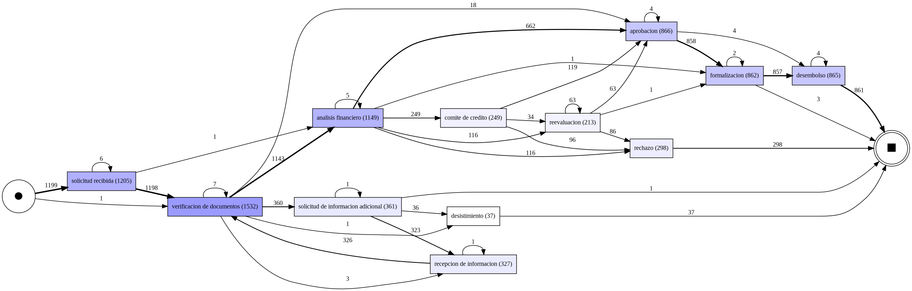

# Corte 2 – Process Mining

## 1. Integrantes

- Integrante 1: **Yileidy Rivera Granados**
- Integrante 2: **Meylin Iliana López Solera**

## 2. Caso seleccionado

**Caso 3: Solicitud y aprobación de créditos.**

El análisis estudia la secuencia real de actividades de las solicitudes de crédito, sus rutas alternativas, los tiempos transcurridos y la presencia de actividades obligatorias según las reglas de negocio. Para ello, se utiliza minería de procesos sobre un registro de eventos sintético, preparado con Python y PM4Py en Google Colab.

## 3. Descripción de los datos utilizados

El conjunto de datos utilizado corresponde al Caso 3: Solicitud y aprobación de créditos. Contiene información sobre las actividades realizadas durante el procesamiento de solicitudes de crédito, desde su recepción hasta los posibles resultados del trámite.

Cantidad de registros: 7.978 eventos originales.

Cantidad de casos: 1.200 solicitudes de crédito.

Cantidad de actividades: 37 denominaciones originales, que se redujeron a 12 actividades después de la normalización.

Rango temporal: del 5 de enero de 2026 a las 07:29:11 al 30 de junio de 2026 a las 10:55:12.

Variables principales: case_id, activity, timestamp, resource, tipo_credito, monto_solicitado, ingreso_mensual, nivel_endeudamiento, antiguedad_laboral_meses, canal y edad_solicitante.

Problemas de calidad detectados: se identificaron 14 eventos sin marca temporal válida, equivalentes aproximadamente al 0,18 % de los registros originales. También se encontraron 31 filas completamente duplicadas y diferencias en la escritura de los nombres de las actividades. No se detectaron valores nulos en las columnas case_id ni activity.

Los problemas encontrados evidencian la necesidad de preparar los datos antes de realizar el análisis de minería de procesos. En particular, las fechas faltantes limitan el análisis cronológico, mientras que los registros duplicados requieren revisión para determinar si representan eventos repetidos válidos o errores de registro.

## 4. Preparación de datos

| **Transformación** | **Motivo** | **Efecto sobre los datos** |
| --- | --- | --- |
| Conservación de una copia del conjunto original | Evitar perder evidencia durante la limpieza y permitir validaciones posteriores | Se mantiene el conjunto completo de 7.978 eventos para comprobaciones de presencia de actividades. |
| Normalización de `activity`: minúsculas, espacios y eliminación de tildes | Unificar etiquetas equivalentes escritas de distintas maneras | De 37 denominaciones diferentes se pasa a 12 actividades normalizadas, sin eliminar eventos por esta operación. |
| Conversión de `timestamp` a tipo fecha-hora con `errors="coerce"` | Habilitar el ordenamiento y las mediciones temporales | Se identifican 14 registros con fecha ausente o no interpretable. |
| Exclusión de eventos sin fecha del Event Log temporal | Evitar secuencias o duraciones basadas en fechas desconocidas | El Event Log temporal queda con **7.964 eventos** y mantiene **1.200 solicitudes**. |
| Ordenamiento por `case_id` y `timestamp` | Reconstruir secuencias de actividades por solicitud | Permite identificar variantes y calcular tiempos entre eventos consecutivos. |
| Conservación de eventos sin fecha para validaciones de presencia | No confundir falta de fecha con falta de actividad | Las comprobaciones de reglas utilizan los eventos originales, incluidos los 14 que no tienen fecha. |

## 5. Event Log final

El Event Log del Caso 3: Solicitud y aprobación de créditos se construyó mediante Python en Google Colab, utilizando la biblioteca pandas para la preparación y organización de los datos. El código correspondiente se encuentra en el notebook scripts/Colab_Corte2.ipynb.

El archivo de salida establecido es datos/processed/caso_03_event_log.csv. Los datos procesados pueden regenerarse a partir del conjunto de datos original mediante la ejecución del notebook, por lo que no es necesario almacenarlos permanentemente en GitHub.

Para la construcción del Event Log se utilizaron los siguientes atributos:

Case ID: case_id, identificador único de cada solicitud de crédito, que permite agrupar los eventos correspondientes a un mismo trámite.

Activity: activity, nombre normalizado de la actividad realizada durante el procesamiento de la solicitud.

Timestamp: timestamp, fecha y hora en que se registró cada actividad, utilizada para ordenar cronológicamente los eventos.

Otros atributos utilizados: resource, tipo_credito, monto_solicitado, ingreso_mensual, nivel_endeudamiento, antiguedad_laboral_meses, canal y edad_solicitante. También se conservó activity_original para mantener la trazabilidad de los nombres originales de las actividades.

Muestra representativa del Event Log

La siguiente tabla presenta la secuencia de eventos correspondiente a la solicitud SOL00001, mostrando las actividades realizadas, sus marcas temporales y los recursos asociados.

| Case ID | Actividad | Timestamp | Recurso |
|---|---|---|---|
| SOL00001 | solicitud recibida | 2026-01-16 08:27:56 | Ejecutivo_03 |
| SOL00001 | verificacion de documentos | 2026-01-19 08:00:00 | Verificador_01 |
| SOL00001 | analisis financiero | 2026-01-20 08:00:00 | Analista_02 |
| SOL00001 | aprobacion | 2026-01-20 15:22:31 | Analista_02 |
| SOL00001 | formalizacion | 2026-01-26 08:00:00 | Ejecutivo_01 |
| SOL00001 | desembolso | 2026-01-27 08:00:00 | Tesoreria |

El Event Log preparado para el análisis cronológico contiene 7.964 eventos correspondientes a 1.200 solicitudes de crédito. Esta cantidad es inferior a los 7.978 registros originales debido a que se excluyeron 14 eventos que no contaban con una marca temporal válida.

Los eventos sin fecha se conservaron en los datos originales para las comprobaciones que no requieren información cronológica, especialmente la verificación de presencia de actividades.

La construcción del Event Log permite representar las actividades realizadas en cada solicitud, identificar las diferentes rutas del proceso y desarrollar los análisis de variantes, tiempos y cumplimiento de las reglas establecidas.

## 6. Descubrimiento del proceso
Para analizar el comportamiento real del proceso de solicitud y aprobación de créditos, se aplicó la técnica Directly-Follows Graph (DFG) mediante la biblioteca PM4Py en Python.

Esta técnica permite identificar las relaciones directas entre las actividades registradas en el Event Log, representando gráficamente las secuencias observadas y la frecuencia con la que se ejecutan.

El análisis se realizó utilizando los 7.964 eventos con marcas temporales válidas, correspondientes a 1.200 solicitudes de crédito. A partir de estos registros, se generó un mapa que permite visualizar las principales rutas del proceso y las actividades que intervienen en su ejecución.

Mapa del proceso descubierto

Interpretación

El proceso descubierto presenta una ruta predominante conformada por las siguientes actividades:

Solicitud recibida → Verificación de documentos → Análisis financiero → Aprobación → Formalización → Desembolso.

Esta secuencia representa el recorrido habitual de una solicitud que completa satisfactoriamente las etapas de evaluación, aprobación y otorgamiento del crédito.

Sin embargo, el análisis también permitió identificar rutas alternativas que incluyen actividades como la solicitud y recepción de información adicional, la participación del comité de crédito y la reevaluación de solicitudes. Asimismo, existen recorridos que finalizan con rechazo o desistimiento, lo que evidencia que no todas las solicitudes siguen el mismo procedimiento hasta su finalización.

La existencia de estas rutas alternativas refleja la variabilidad del proceso, que puede estar relacionada con las características de cada solicitud, los requisitos de evaluación y las decisiones tomadas durante el trámite.

El mapa DFG permite reconocer las actividades y transiciones más frecuentes, así como identificar posibles puntos del proceso que requieren un análisis más detallado. No obstante, esta representación por sí sola no permite determinar si una secuencia cumple correctamente todas las políticas establecidas ni identificar las causas de las diferencias observadas.

